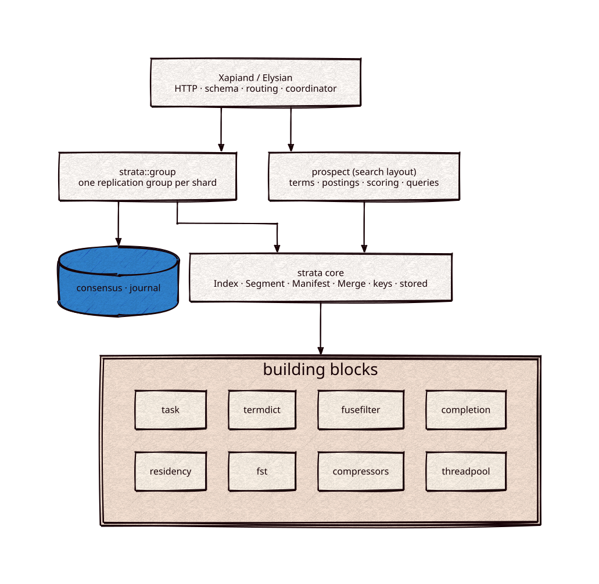

# strata

[](https://github.com/Kronuz/strata/actions/workflows/ci.yml)
[](LICENSE)


An embeddable, MIT-licensed segment store in C++20, LSM-style: writes produce immutable
segments, merges run in the background under a policy and a memory budget, and commits are
crash-safe. A segment's contents come from plugins named by a layout: the document layout
alone is a key-value store, and [prospect](https://github.com/Kronuz/prospect), the search
library, is the layout that adds terms, postings, and scoring. Together they replace Xapian
inside [Xapiand](https://github.com/Kronuz/Xapiand) on the way to Elysian, its successor.



## ✨ Highlights

- 🧱 **Immutable segments** with crash-safe commits, verified against power loss,
  disk-full, and media faults (`faultfs`).
- 🧩 **Layouts of plugins**: the core folds over a layout's plugins and never names a search
  type. `keys` (a sorted key dictionary and a fuse filter) and `stored` (zstd records) are the
  core's own; prospect adds the inverted plugin.
- 🔁 **Lifecycle**: tiered background merges, reclamation of dropped files in bounded steps,
  checkpoints installed into another index, digests, and `check()`.
- 📐 **One indexing budget per node**: when it is exceeded, the largest buffer flushes first.
- 🧩 **Built from small libraries**: [termdict](https://github.com/Kronuz/termdict),
  [fusefilter](https://github.com/Kronuz/fusefilter),
  [completion](https://github.com/Kronuz/completion),
  [task](https://github.com/Kronuz/task), and more; see
  [cpp-libraries](https://github.com/Kronuz/cpp-libraries).
- 📏 **Ratcheted against RocksDB** on the key-value rows, as prospect is against Lucene,
  Tantivy, and Xapian on search.

## 🚧 Status

strata is under active development and its API changes between phases. Phases 0
through 2 have passed their gates. Phase 3 (index lifecycle) has reported its
durability rows, and its performance rows are being measured. On 2026-10-20 the search side
moved to prospect with its history; this repository keeps the core.
[docs/PLAN.md](docs/PLAN.md) has the phases, and [docs/gates/](docs/gates) has the core's
measured rows.

## 📦 Installation

Requires a C++20 compiler and CMake 3.18 or newer; the libraries it builds on are
fetched at configure time. CI builds it on Linux (x86_64, arm64), macOS (arm64,
x86_64), and FreeBSD, plus ASan, UBSan, and TSan builds.

```cmake
include(FetchContent)
FetchContent_Declare(strata
  GIT_REPOSITORY https://github.com/Kronuz/strata.git
  GIT_TAG        main)
FetchContent_MakeAvailable(strata)

target_link_libraries(my_app PRIVATE strata::core)
```

For search, link `prospect::prospect` instead; it fetches strata itself.

## 🚀 Quick start

```sh
git clone https://github.com/Kronuz/strata.git && cd strata
cmake -B build -DCMAKE_BUILD_TYPE=Release && cmake --build build
ctest --test-dir build
```

The tests are the current usage examples: `test/core_kv_test.cc` drives the document layout as a
key-value store through puts, deletes, flushes, merges, commits, reopens, and a checkpoint;
`bench/kv/kv_strata.cc` is the same layout as a benchmark driver.

## 🎯 When to use it

- ✅ Following or contributing to the engine, or embedding it experimentally.
- ✅ Building a layout of your own on the core's plugins.
- ❌ Production storage today: use RocksDB until strata's key-value rows pass their gate.
- ❌ Search: that is [prospect](https://github.com/Kronuz/prospect).

## 📚 Documentation

- [docs/ARCHITECTURE.md](docs/ARCHITECTURE.md): layers, segments, and the write path;
  prospect's [ARCHITECTURE](https://github.com/Kronuz/prospect/blob/main/docs/ARCHITECTURE.md)
  has the read path.
- [docs/PLAN.md](docs/PLAN.md): phases, ratchets, and gates, for both repositories.
- [docs/design/core-split.md](docs/design/core-split.md): what the core asks of a layout, and
  the boundary checks.
- [docs/REPLICATION.md](docs/REPLICATION.md) and
  [docs/DISTRIBUTION.md](docs/DISTRIBUTION.md): replication groups, placement, and
  membership.
- [docs/BENCHMARKS.md](docs/BENCHMARKS.md) and [docs/TESTING.md](docs/TESTING.md): how
  it is measured and tested.
- [AGENTS.md](AGENTS.md): repository map and working rules.

## 🤝 Contributing

Read [AGENTS.md](AGENTS.md) first: strata is a clean-room implementation, and every
change goes through its phase gates. CI must pass on every platform.

## 📄 License

MIT, Copyright (c) 2026 Germán Méndez Bravo. See [LICENSE](LICENSE).
