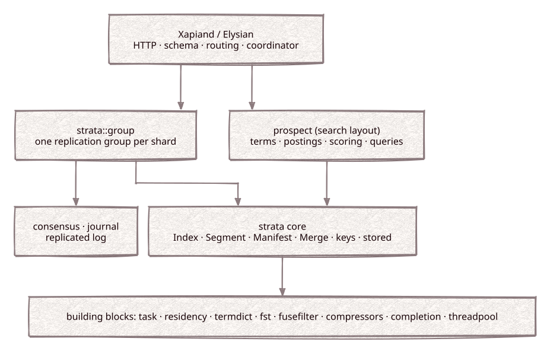

# strata

Part of [Kronuz C++ Libraries](https://github.com/Kronuz/cpp-libraries), a collection of small, reusable C++ libraries.

[](https://github.com/Kronuz/strata/actions/workflows/ci.yml)
[](LICENSE)


Embeddable segment store for C++20: immutable segments, background merges under a memory budget, and crash-safe commits.
It is LSM-style: writes produce immutable segments, merges run in the background
under a policy, and plugins named by a layout fill each segment. The document
layout alone is a key-value store, and [prospect](https://github.com/Kronuz/prospect),
the search library, is the layout that adds terms, postings, and scoring;
together they are built to replace Xapian inside [Xapiand](https://github.com/Kronuz/Xapiand)
and its successor, Elysian.



## ✨ Highlights

- **Immutable segments** with crash-safe commits, verified against power loss,
  disk-full, and media faults (`faultfs`).
- **Layouts of plugins.** The core folds over a layout's plugins and never names a
  search type: `keys` (a sorted key dictionary and a fuse filter) and `stored`
  (records in LZ4 or zstd blocks) are the core's own, and prospect adds the
  inverted plugin.
- **Lifecycle.** Tiered background merges, reclamation of dropped files in bounded
  steps, checkpoints installed into another index, digests, and `check()`.
- **One indexing budget per node.** When it is exceeded, the largest buffer
  flushes first.
- **Built from small libraries:** [termdict](https://github.com/Kronuz/termdict),
  [fusefilter](https://github.com/Kronuz/fusefilter),
  [completion](https://github.com/Kronuz/completion),
  [task](https://github.com/Kronuz/task), and more from the
  [catalog](https://github.com/Kronuz/cpp-libraries).
- **Ratcheted against RocksDB** on the key-value rows, as prospect is against
  Lucene, Tantivy, and Xapian on search.

## 🚀 Quick start

```cpp
#include "completion/posix.h"
#include "strata/core/index.hh"

#include <cstdio>
#include <filesystem>

using kv_index = strata::basic_index<strata::document_layout>;

int main() {
	const auto dir = std::filesystem::temp_directory_path() / "strata-quick-start";
	std::filesystem::remove_all(dir);
	std::filesystem::create_directories(dir);
	kronuz::journal::PosixIO io(dir);

	kv_index::options opts;
	opts.keyed = true;  // documents are addressed by key
	auto ix = kv_index::create(io, opts, {'q', 'u', 'i', 'c', 'k'});

	kv_index::operation put;
	put.type = kv_index::operation::replace_key;
	put.key = put.doc.key = "greeting";
	put.doc.stored = "hello, strata";
	kv_index::transaction tx;
	tx.ops.push_back(put);
	if (ix.apply(tx, {}).result != strata::verdict::accepted) return 1;
	ix.commit();  // durable from here on

	ix.close();
	ix = kv_index::open(io, opts);
	std::printf("%s\n", ix.get("greeting")->c_str());  // hello, strata
	ix.close();
}
```

[`test/core_kv_test.cc`](test/core_kv_test.cc) drives the same layout through
puts, deletes, flushes, merges, commits, reopens, and a checkpoint, and
[`bench/kv/kv_strata.cc`](bench/kv/kv_strata.cc) is it as a benchmark driver.

## 📦 Installation

Requires a C++20 compiler and CMake 3.18 or newer; it fetches eleven sibling
libraries (fst, task, hashes, crc32c, residency, varint, termdict, compressors,
fusefilter, completion, threadpool), and compressors builds pinned LZ4 and zstd.
CI builds it on Linux (x86_64, arm64), macOS (arm64, x86_64), and FreeBSD, plus
ASan, UBSan, and TSan builds.

```cmake
include(FetchContent)
FetchContent_Declare(strata
  GIT_REPOSITORY https://github.com/Kronuz/strata.git
  GIT_TAG        93b53225cb3b5ccf2976fdfb01a76a39923e6c7d)  # or main for the tip
FetchContent_MakeAvailable(strata)

target_link_libraries(my_app PRIVATE strata::core)
```

```cpp
#include "strata/core/index.hh"
```

For search, link `prospect::prospect` instead; it fetches strata itself.

## 🎯 When to use it

Use it to follow or contribute to the engine, to embed it experimentally, or to
build a layout of your own on the core's plugins.

Not for:

- **A stable API or format.** The API changes between phases, and the on-disk
  format stays open until the first release; [docs/STATUS.md](docs/STATUS.md)
  says where the phases stand.
- **Production storage.** Use RocksDB until strata's key-value rows pass their
  gate.
- **Search.** That is [prospect](https://github.com/Kronuz/prospect).

## 📚 Documentation

- [docs/ARCHITECTURE.md](docs/ARCHITECTURE.md): layers, segments, and the write path;
  prospect's [ARCHITECTURE](https://github.com/Kronuz/prospect/blob/main/docs/ARCHITECTURE.md)
  has the read path.
- [docs/STATUS.md](docs/STATUS.md): where the phases stand.
- [docs/PLAN.md](docs/PLAN.md): phases, ratchets, and gates, for both repositories.
- [docs/design/core-split.md](docs/design/core-split.md): what the core asks of a layout, and
  the boundary checks.
- [docs/REPLICATION.md](docs/REPLICATION.md) and
  [docs/DISTRIBUTION.md](docs/DISTRIBUTION.md): replication groups, placement, and
  membership.
- [docs/BENCHMARKS.md](docs/BENCHMARKS.md) and [docs/TESTING.md](docs/TESTING.md): how
  it is measured and tested.
- [AGENTS.md](AGENTS.md): repository map and working rules.
- [Kronuz C++ Libraries](https://github.com/Kronuz/cpp-libraries): the catalog of the
  building blocks.

## 🛠️ Building and testing

```sh
cmake -B build -DCMAKE_BUILD_TYPE=Release
cmake --build build
ctest --test-dir build
```

The tests are the usage examples: `test/core_kv_test.cc` runs the document
layout as a key-value store against a `std::map`.

## 🤝 Contributing

Read [AGENTS.md](AGENTS.md) first: strata is a clean-room implementation, and every
change goes through its phase gates. CI must pass on every platform.

## 📄 License

MIT, Copyright (c) 2026 Germán Méndez Bravo. See [LICENSE](LICENSE).
